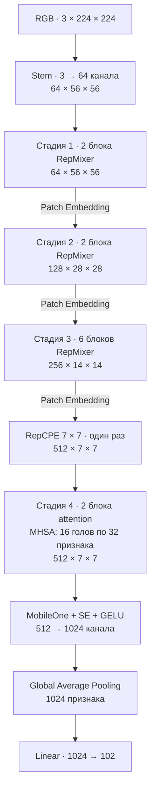
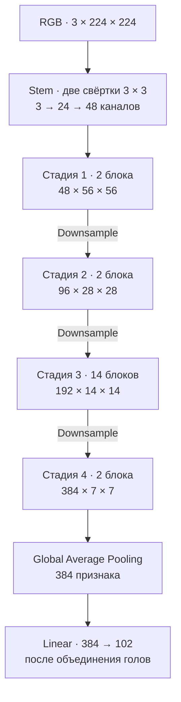

# FastViT и RepViT для классификации цветов

Сравнение FastViT-SA12 и RepViT-M0.9 на Oxford Flowers 102 с подготовкой моделей для Samsung Galaxy A34 5G.

## Архитектуры моделей

### FastViT-SA12

Первые три стадии смешивают пространственные признаки через RepMixer. На последней стадии attention работает с 49 токенами карты 7 × 7. [Детальная схема FastViT-SA12](docs/FastViT-SA12.drawio)

### RepViT-M0.9

В блоках RepViT пространственные признаки смешивает RepVGGDW, а каналы — FFN. Внутри каждой стадии чередуются блоки с SE и без SE. [Детальная схема RepViT-M0.9](docs/RepViT-M0.9.drawio)

## Что где лежит

| Где искать | Что там |
|---|---|
| [report.md](report.md) | Результаты по seed, график обучения и проверка экспорта |
| [Обучение и оценка](docs/TRAIN_EVAL.md) | Подготовка окружения, загрузка датасета, обучение, оценка и экспорт |
| [Мобильные замеры в отчёте](report.md#мобильные-замеры) | Таблица и диаграммы задержки и точности на Galaxy A34, пояснения к показателям и выводы |
| [Сводка мобильных замеров](mobile_comparison.csv) · [CSV отдельных прогонов](report_phone/) | Сводные показатели для 1, 2 и 4 потоков CPU и данные шести испытаний |
| [Тестирование на Galaxy A34](docs/PHONE.md) | Установка приложения, запуск замеров, выгрузка CSV и обновление отчёта |
| [Устройство проекта](docs/ARCHITECTURE.md) | Архитектуры моделей и схема работы |
| [FastViT-SA12](docs/FastViT-SA12.drawio) · [RepViT-M0.9](docs/RepViT-M0.9.drawio) | Редактируемые схемы моделей |
| [coursework/](coursework/) · [configs/](configs/) | Python-код и параметры экспериментов |
| [android/](android/) | Приложение Android |
| [requirements.txt](requirements.txt) | Версии Python-зависимостей для окружения экспериментов |
| `data/`, `runs/`, `exports/` | Датасет, локальные запуски и экспортированные модели |
