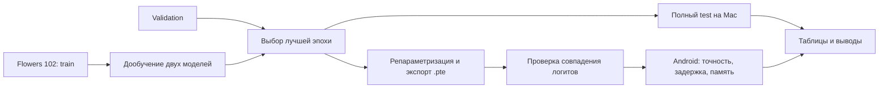

# Соответствие схем и кода

Актуальные схемы. [FastViT-SA12](FastViT-SA12.drawio) · [RepViT-M0.9](RepViT-M0.9.drawio).

Схемы сверены с реализациями `timm==1.0.22`, использованными при обучении.

## Путь от данных до Android

## FastViT-SA12

Конфигурация: `fastvit_sa12.apple_dist_in1k`. SA12 дообучен из предобученного ImageNet checkpoint по протоколу проекта.

| Стадия | Каналы | Размер при 224×224 | Блоки | Token mixer |
|---|---:|---:|---:|---|
| 1 | 64 | 56×56 | 2 | RepMixer |
| 2 | 128 | 28×28 | 2 | RepMixer |
| 3 | 256 | 14×14 | 6 | RepMixer |
| 4 | 512 | 7×7 | 2 | MHSA: 16 голов по 32 |

Исправления:

- RepCPE 7×7 выполняется один раз перед последовательностью блоков стадии 4. Из рамки повторяемого блока вынесен наружу.
- В stem две операции stride 2 не имеют identity-ветви; третья операция stride 1 её имеет. Все три заканчиваются GELU.
- В Patch Embedding нет активации непосредственно после большой групповой свёртки в данной реализации. Далее идёт MobileOne 1×1 с GELU.
- ConvFFN: DW 7×7 + BN → Conv 1×1 (C→4C) → GELU → Conv 1×1 (4C→C). Остаточное сложение показано только на внешней схеме. LayerScale и DropPath указаны в примечании.
- Репараметризация RepCPE добавляет дельта-ядро (единица только в центре). Числовой пример 3×3 иллюстрирует принцип; реальное ядро SA12 — 7×7.
- Финальный MobileOne использует groups=512 и расширяет каналы 512→1024, поэтому identity-ветви в нём нет. Затем SE, GELU, GAP и Linear 1024→102.

При экспорте оставшиеся BatchNorm2d, включая нормализацию перед attention, представлены эквивалентными фиксированными умножением и сложением (`FrozenBatchNorm2d`). Это нужно для XNNPACK ExecuTorch 1.0 и не меняет обученную функцию. Коэффициенты этой нормализации учитываются в числе параметров. Численная эквивалентность проверяется на validation-изображениях.

## RepViT-M0.9

Конфигурация: `repvit_m0_9.dist_450e_in1k`. Модель и её обученные веса не изменялись.

- Каналы 48/96/192/384; число обычных блоков стадий 2/2/14/2. Каждая пара состоит из блока с SE и блока без SE. Pre-block в каждом downsample учитывается отдельно.
- Stem заменён на две обычные Conv 3×3 stride 2: 3→24→48, BN после каждой, GELU только между ними.
- В выбранном варианте RepVggDW: `(3×3 DW + BN) + 1×1 DW + identity`, затем общая BN. После fusion — одна DW 3×3.
- Добавлены остаточные связи вокруг FFN в обычных блоках и downsample. FFN: Conv 1×1+BN → GELU → Conv 1×1+BN, расширение ×2.
- SE остаётся после fusion. Классификатор выбранного distillation-варианта до fusion усредняет две BN+Linear головы; после fusion — одна Linear 384→102. Учитель при нашем дообучении не используется.

## Объединение BatchNorm со свёрткой

В режиме `eval` среднее и дисперсия BatchNorm фиксированы. Для каждого выходного канала коэффициент `a = gamma / sqrt(var + eps)` даёт эквивалентную свёртку с весами `W' = a * W` и смещением `b' = beta + a * (b - mean)`. Совместимые линейные ветви складываются после приведения ядер к одному размеру. Для identity используется дельта-ядро.

## Области применения для обзора

| Задача | Зачем нужны компактные модели | Что требуется для решения |
|---|---|---|
| Классификация на телефоне | Локальная обработка с ограниченной памятью | Классификационная голова и размеченные изображения. Этот сценарий реализован в курсовой |
| Распознавание растений, товаров и деталей | Обработка снимка на устройстве | Целевой датасет и дообучение на нужных классах |
| Детекция и сегментация | Обработка кадров на периферийном устройстве | Детектор или декодер, разметка рамок или масок |
| Поиск похожих изображений | Сравнение большого числа компактных признаков | Эмбеддинги, метрика и поисковый индекс |
| Контроль качества на производстве | Локальная обработка изображений деталей | Данные о дефектах и оценка ошибок |

## Источники

- Vasu et al., ICCV 2023. [Статья о FastViT](https://arxiv.org/abs/2303.14189).
- Wang et al., CVPR 2024. [Статья о RepViT](https://arxiv.org/abs/2307.09283).

- [Официальный FastViT](https://github.com/apple-aiml-research/ml-fastvit)
- [Официальный RepViT](https://github.com/THU-MIG/RepViT)
- [Код FastViT timm 1.0.22](https://github.com/huggingface/pytorch-image-models/blob/v1.0.22/timm/models/fastvit.py)
- [Код RepViT timm 1.0.22](https://github.com/huggingface/pytorch-image-models/blob/v1.0.22/timm/models/repvit.py)

Сравнение SA12 и M0.9 не является сравнением при равном числе параметров: выводы следует формулировать как сравнение двух конкретных вариантов. Мобильная скорость определяется замерами на Samsung, а не именем модели или опубликованными измерениями iPhone.
