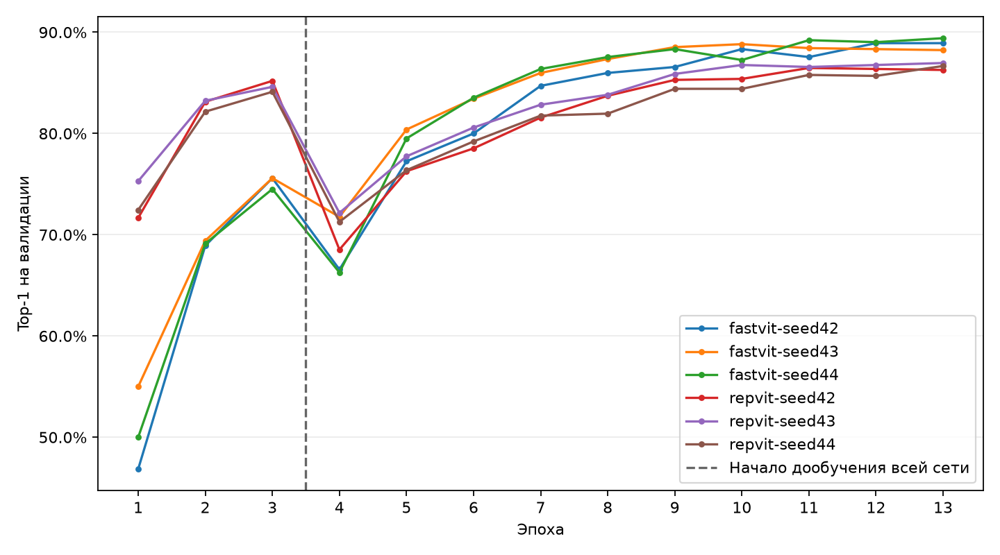
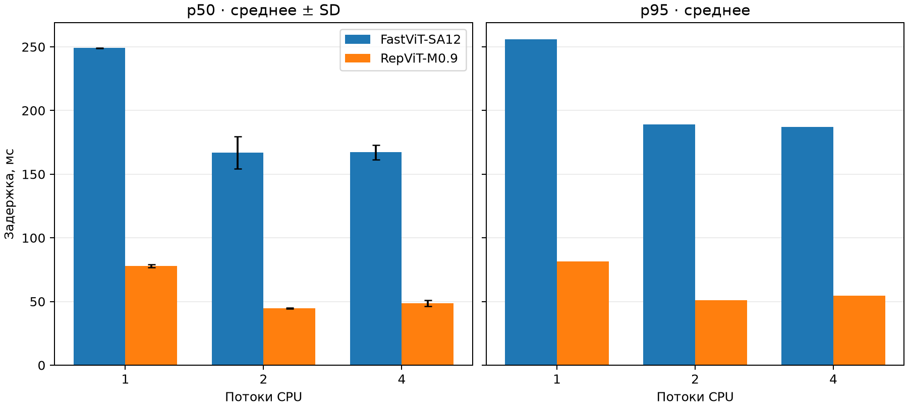
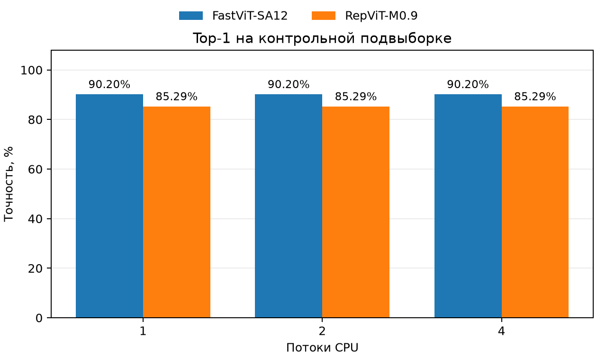

# Реальные результаты экспериментов

| Модель | Seed | Test accuracy | Macro-F1 | Обучение, мин |
|---|---:|---:|---:|---:|
| fastvit_sa12.apple_dist_in1k | 42 | 0.8759 | 0.8673 | 6.0 |
| fastvit_sa12.apple_dist_in1k | 43 | 0.8696 | 0.8622 | 6.9 |
| fastvit_sa12.apple_dist_in1k | 44 | 0.8676 | 0.8591 | 7.1 |
| repvit_m0_9.dist_450e_in1k | 42 | 0.8335 | 0.8253 | 6.1 |
| repvit_m0_9.dist_450e_in1k | 43 | 0.8460 | 0.8335 | 7.0 |
| repvit_m0_9.dist_450e_in1k | 44 | 0.8424 | 0.8285 | 6.9 |

## Устойчивость по seed 42, 43 и 44

Среднее ± выборочное стандартное отклонение (n = 3). Метрики указаны в процентах, отклонения — в процентных пунктах.

| Модель | Top-1 accuracy | Macro-F1 | Средняя точность по классам |
|---|---:|---:|---:|
| fastvit_sa12.apple_dist_in1k | 87.10 ± 0.43 | 86.29 ± 0.42 | 88.22 ± 0.33 |
| repvit_m0_9.dist_450e_in1k | 84.06 ± 0.65 | 82.91 ± 0.41 | 86.06 ± 0.27 |

Парная разница Top-1 (fastvit_sa12.apple_dist_in1k минус repvit_m0_9.dist_450e_in1k) по seed 42, 43 и 44: +4.24, +2.36, +2.52 п. п. Среднее ± SD: +3.04 ± 1.05 п. п.

## Как шло обучение

По горизонтали отложены эпохи обучения, по вертикали — доля правильных предсказаний на валидационной выборке (Top-1). Каждая линия соответствует одной модели и одному seed.

До эпохи 4 обучалась только классификационная голова. Пунктир отмечает переход к дообучению всей сети.

На первой эпохе дообучения всей сети точность снизилась во всех запусках на 3.82–16.67 п. п.

Затем точность восстановилась. Лучший результат дообучения в каждом запуске превысил максимум этапа обучения головы. К концу кривые меняются уже не так сильно, и в некоторых запусках максимум достигнут до последней эпохи.

Для оценки на test использовали веса с максимальной Top-1 на валидации. Если максимум достигнут несколько раз, берётся первая из этих эпох.

| Запуск | Лучшая эпоха | Top-1 на валидации |
|---|---:|---:|
| fastvit-seed42 | 12 | 88.92% |
| fastvit-seed43 | 10 | 88.82% |
| fastvit-seed44 | 13 | 89.41% |
| repvit-seed42 | 11 | 86.47% |
| repvit-seed43 | 13 | 86.96% |
| repvit-seed44 | 13 | 86.67% |

<!-- Результаты экспорта и запуска -->

## Базовый запуск и экспорт

| Модель | Test accuracy | Macro-F1 | Параметры deployment | .pte, МиБ | MACs, млрд |
|---|---:|---:|---:|---:|---:|
| FastViT-SA12 | 87.59% | 0.8673 | 10,624,870 | 40.69 | 1.476 |
| RepViT-M0.9 | 83.35% | 0.8253 | 4,721,326 | 18.10 | 0.815 |

В базовом запуске разность accuracy составляет 4,24 процентного пункта в пользу SA12. SA12 имеет больше параметров. Разброс по трём запускам приведён в разделе об устойчивости.

MACs — приближение по покрытию PyTorch FlopCounter, не предсказание задержки на Samsung. Исходное предобучение моделей различается; downstream-настройки одинаковы. Время обучения сохранено в training.json, но фоновые нагрузки не контролировались, поэтому строгий вывод о скорости обучения по нему не делается.

При экспорте на восьми validation-изображениях максимальное абсолютное расхождение логитов составило 5.72e-05 для SA12 и 8.26e-06 для M0.9. Top-1 на этих примерах сохранён. Это проверка переноса, а не оценка экспортированных моделей на всём test.

Метрики по классам и графики находятся в runs/report. Тестовые прогнозы сохранены в runs/full. Мобильный пакет содержит 102 фиксированных тестовых примера и эталонные логиты .pte.

Повторная проверка мобильного пакета выявила, что Python передавал эталонные изображения в ExecuTorch с раскладкой памяти, отличной от плотного NCHW в Android. Вход генератора приведён к плотному NCHW, эталоны пересчитаны. На Mac классы исходной сети и .pte совпали на всех 102 фотографиях для каждой модели. Максимальная абсолютная ошибка логитов составила 1.91e-4 для SA12 и 2.38e-5 для M0.9. Верных прогнозов 92/102 и 87/102 соответственно. Это проверка на фиксированной подвыборке. [Данные проверки](runs/report/desktop_bundle_check.json).

Android-пакет прошёл проверку Gradle.

<!-- mobile-results:start -->
## Мобильные замеры

| Устройство | Модель | Потоки | Испытания | p50, мс | SD p50, мс | p95, мс | Top-1 на подвыборке | Макс. тепловой статус |
|---|---|---:|---:|---:|---:|---:|---:|---:|
| samsung SM-A346E | FastViT-SA12 | 1 | 2 | 249.08 | 0.27 | 256.08 | 90.20% | 1 |
| samsung SM-A346E | RepViT-M0.9 | 1 | 2 | 77.90 | 1.10 | 81.57 | 85.29% | 1 |
| samsung SM-A346E | FastViT-SA12 | 2 | 2 | 166.82 | 12.68 | 189.16 | 90.20% | 2 |
| samsung SM-A346E | RepViT-M0.9 | 2 | 2 | 44.75 | 0.37 | 51.12 | 85.29% | 1 |
| samsung SM-A346E | FastViT-SA12 | 4 | 2 | 167.26 | 5.77 | 187.19 | 90.20% | 2 |
| samsung SM-A346E | RepViT-M0.9 | 4 | 2 | 48.77 | 2.41 | 54.77 | 85.29% | 2 |

### Что означают колонки

- **Устройство** — модель телефона, на котором проводились замеры.
- **Модель** — нейросеть, для которой рассчитаны показатели.
- **Потоки** — число потоков CPU, заданное при запуске модели.
- **Испытания** — число отдельных прогонов в этом режиме.
- **p50, мс** — медианная задержка одного вызова модели, усреднённая по испытаниям.
- **SD p50, мс** — выборочное стандартное отклонение медианной задержки между испытаниями.
- **p95, мс** — порог задержки, в который уложились не менее 95% замеров в каждом испытании. В таблице приведено среднее этих порогов.
- **Top-1 на подвыборке** — средняя по испытаниям доля фото, для которых класс с наибольшей оценкой совпал с правильным.
- **Макс. тепловой статус** — наибольший статус Android, записанный после замеров среди испытаний для этой модели и числа потоков. Код 1 означает лёгкое ограничение производительности из-за нагрева, код 2 — умеренное. [Документация Android](https://developer.android.com/reference/android/os/PowerManager#THERMAL_STATUS_LIGHT)

После каждого прогона журнал приложения показывает p50, p95 и число правильных предсказаний. В сохранённом CSV эти показатели находятся в строках `summary` под ключами `p50_ms`, `p95_ms` и `subset_accuracy`. Там же указаны тепловые статусы до и после замеров под ключами `thermal_before` и `thermal_after`. [CSV отдельных прогонов](report_phone/)

[Сводный CSV](mobile_comparison.csv)

### Диаграммы мобильных замеров

<!-- mobile-results:end -->

### Итоги замеров на Galaxy A34

RepViT-M0.9 показала меньшие p50 и p95 при всех трёх настройках числа потоков. Её лучшие результаты получены на двух потоках: p50 — 44,75 мс, p95 — 51,12 мс. У FastViT-SA12 задержки на двух и четырёх потоках оказались близкими. По точности на 102 контрольных фото FastViT-SA12 опередила RepViT-M0.9 (90,20% против 85,29%).
